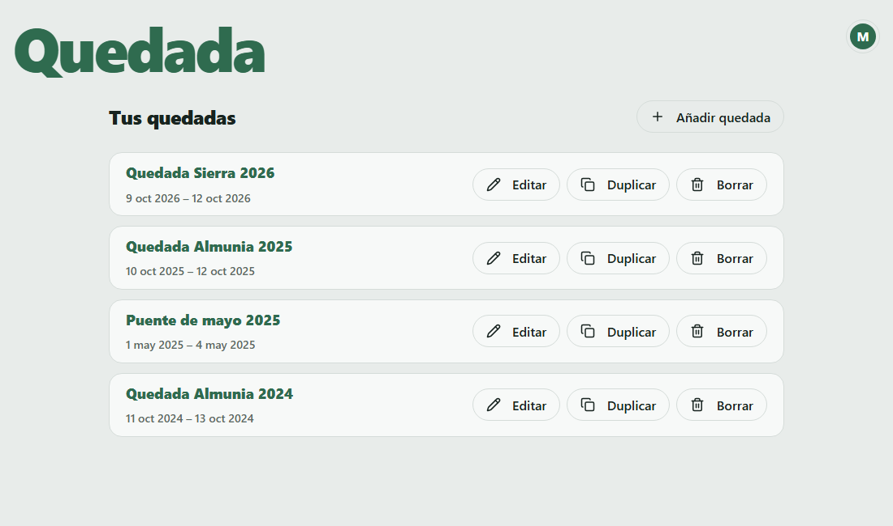
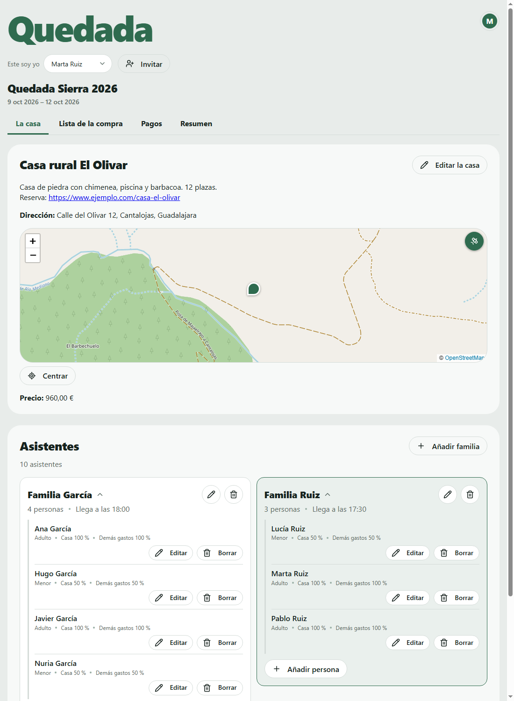
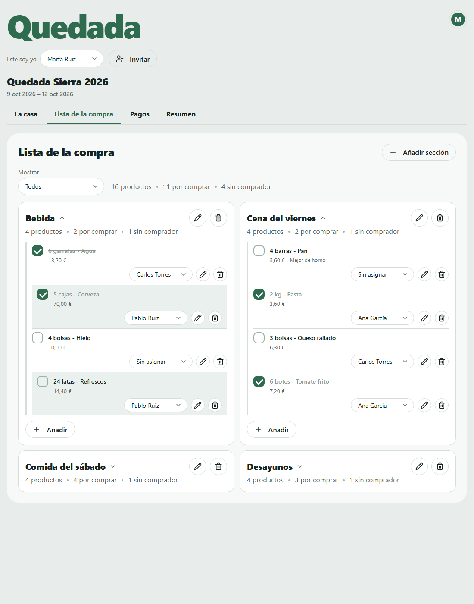
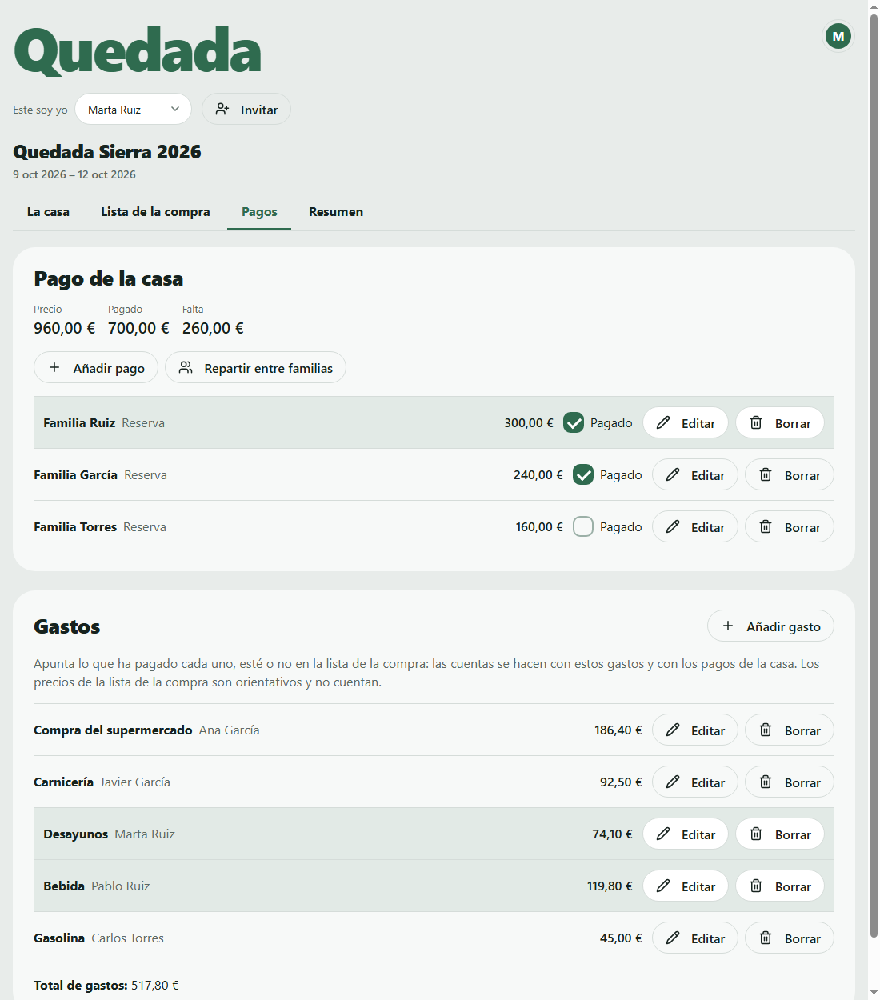
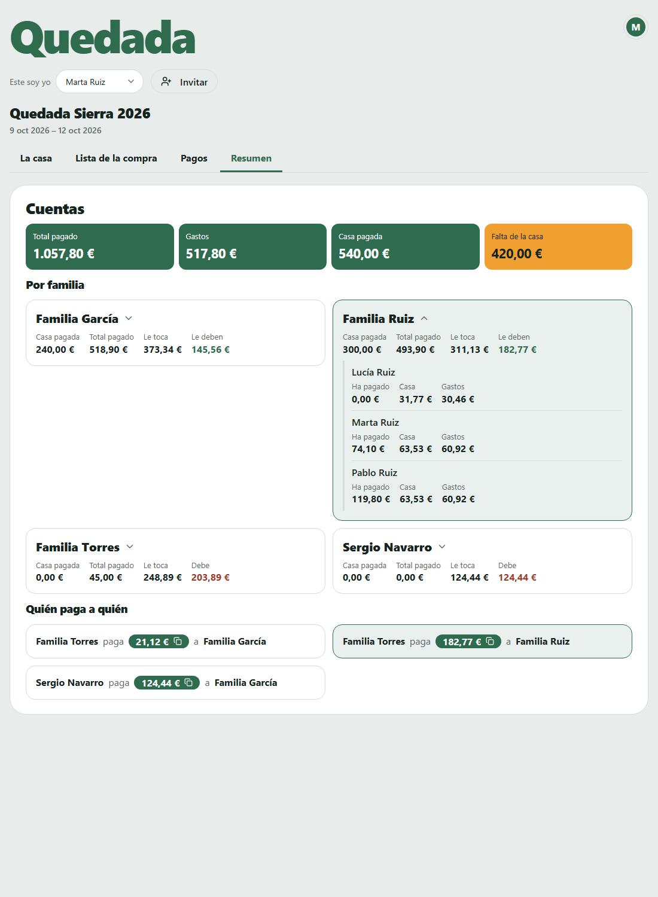

# Quedada

Aplicación web para organizar quedadas de casa rural entre amigos: quién viene, la lista de la compra, lo que ha pagado cada uno y quién debe a quién. Sustituye al Excel que se usaba hasta ahora.

- **Web:** https://onzebol.github.io/quedada/
- **Código:** https://github.com/Onzebol/quedada

Se entra con una cuenta de Google. Cada quedada es de quien la crea y se comparte con un enlace de invitación; los cambios de los demás aparecen sin recargar. Se puede instalar como aplicación (PWA) en el móvil y el ordenador. Todos los nombres, cantidades e importes de las capturas son inventados.

## Qué hace

### Tus quedadas

Lista de quedadas por fecha, con crear, editar, duplicar (copia la casa, las personas y la lista de la compra, sin pagos ni gastos) y borrar.



### La casa

Ficha de la casa (descripción con enlaces, dirección, precio y mapa con «Mapa/Satélite» y botón «Navegar» en el móvil) y los asistentes agrupados por familias, con la hora de llegada, si son adultos o menores y el porcentaje que paga cada uno de la casa y de los demás gastos. «Este soy yo» resalta lo tuyo y de tu familia.



### Lista de la compra

Secciones plegables (cena del viernes, desayunos…) con productos, cantidad, precio orientativo, quién los compra, observaciones y casilla de comprado. El filtro «Mostrar» enseña lo de cada persona, lo pendiente o lo que no tiene comprador.



### Pagos

Pagos del alquiler por familia (reserva, resto…, con casilla «Pagado» y «Repartir entre familias») y gastos reales de cada uno, con foto opcional del tique.



### Resumen

Totales, ficha por familia (lo pagado, lo que le toca y su saldo, con desglose por persona) y «Quién paga a quién» con el mínimo de transferencias; el importe se copia con un toque.



## Instalación

Requisitos: Node.js 22 o superior, npm y un proyecto gratuito de [Supabase](https://supabase.com) (guarda los datos y valida las cuentas) con un cliente OAuth de Google. **Sin esa configuración la app solo muestra la pantalla de entrada.**

```bash
git clone https://github.com/Onzebol/quedada.git
cd quedada
npm install
cp .env.example .env.local   # y rellena las variables (ver abajo)
npm run dev                  # http://localhost:39726/quedada/
```

El servidor de desarrollo usa siempre el puerto **39726** (`strictPort`): es la dirección que se autoriza en Supabase y Google. Si está ocupado, falla en vez de cambiar de puerto.

### Variables de entorno

Se leen en la compilación (Vite), así que son **públicas**: acaban en el JavaScript que recibe el navegador. Nunca pongas aquí la clave `service_role` de Supabase.

| Variable | Obligatoria | Qué es | Dónde se saca |
|---|---|---|---|
| `VITE_SUPABASE_URL` | Sí | URL del proyecto, `https://xxxx.supabase.co` | Supabase → Project Settings → API |
| `VITE_SUPABASE_CLAVE_PUBLICA` | Sí | Clave `anon`/publishable | Supabase → Project Settings → API |
| `VITE_GOOGLE_CLIENT_ID` | Recomendada | Client ID de OAuth de Google. Con ella se usa el botón oficial de Google, que no muestra la URL de Supabase; sin ella, «Entrar con Google» redirige a Supabase | Google Cloud Console → Credenciales |

En local van en `.env.local` (ignorado por git; plantilla en `.env.example`). En el despliegue son **variables de repositorio** de GitHub (no secretos) con otro nombre: `SUPABASE_URL`, `SUPABASE_CLAVE_PUBLICA` y `GOOGLE_CLIENT_ID` (Settings → Secrets and variables → Actions → Variables); `deploy.yml` las pasa a la compilación.

### 1. Base de datos (Supabase)

1. Crea el proyecto y, en el editor SQL, ejecuta **por orden** todos los ficheros de `supabase/migrations/` (`0001` … `0013`). Crean las tablas, la seguridad por fila (cada persona solo ve sus quedadas y las que le han compartido), las invitaciones, el aviso en tiempo real y el bucket privado `tiques` para las fotos.
2. En *Project Settings → Realtime* deja activado Realtime y **desmarcado** «Allow public access» (los canales son privados).
3. Al añadir una migración nueva en el futuro, ejecútala en el editor SQL antes de fusionar la PR que la necesita.

### 2. Inicio de sesión con Google

1. En Google Cloud Console crea un cliente OAuth de tipo «Aplicación web».
2. Orígenes JavaScript autorizados: `https://onzebol.github.io` (o tu dominio) y `http://localhost:39726`.
3. URI de redirección autorizada: la que muestra Supabase en *Authentication → Providers → Google*.
4. En esa misma pantalla de Supabase activa Google y pega el Client ID y el secret. Si usas `VITE_GOOGLE_CLIENT_ID`, el Client ID debe figurar también en «Client IDs».
5. En *Authentication → URL Configuration* añade `https://onzebol.github.io/quedada/` y `http://localhost:39726/quedada/` como URL permitidas.

### 3. Publicar en GitHub Pages

1. En el repositorio: *Settings → Pages → Source: GitHub Actions*.
2. Define las tres variables de repositorio de la tabla anterior.
3. Cada fusión en `main` pasa los tests y publica sola (`.github/workflows/deploy.yml`). La app vive en `/quedada/` (`base` en `vite.config.ts`); si cambias el nombre del repositorio, cámbialo allí y en el manifiesto de la PWA.

## Comandos

| Comando | Qué hace |
|---|---|
| `npm run dev` | Servidor de desarrollo (puerto 39726) |
| `npm test` | Tests (una pasada) |
| `npm run test:watch` | Tests en modo vigilancia |
| `npm run coverage` | Tests con cobertura |
| `npm run lint` | Lint con oxlint |
| `npm run typecheck` | Comprobación de tipos |
| `npm run build` | Compilación de producción en `dist/` |
| `npx vite preview --port 39726 --strictPort` | Sirve la compilación (el service worker y «Instalar» solo existen aquí, no en `dev`) |

## Estructura

- `src/dominio/`: modelo y lógica sin React (tipos, reparto y liquidación, operaciones). El dinero va en céntimos.
- `src/supabase/`, `src/invitaciones/`, `src/autenticacion/`, `src/tiques/`: acceso a Supabase, invitaciones, sesión y fotos de tiques.
- `src/inicio/`, `src/casa/`, `src/asistentes/`, `src/compra/`, `src/cuentas/`: pantallas.
- `src/ui/`, `src/pwa/`: componentes compartidos y app instalable.
- `supabase/migrations/`: esquema y seguridad de la base de datos.
- `docs/capturas/`: capturas de este README (datos inventados).
- `.github/workflows/`: CI y despliegue.

## Cómo se trabaja

- Cada cambio parte de una issue y se hace en su propio git worktree, en `.worktrees/`.
- Los tests se escriben antes que el código (TDD).
- Todo entra por pull request, que cierra su issue con `Closes #<n>` y debe pasar la CI.

Las normas detalladas, también para agentes de IA, y el detalle de cada decisión están en [`AGENTS.md`](AGENTS.md).

## Stack

Vite, React, TypeScript, Supabase (Postgres, Auth, Realtime y Storage), Leaflet, Vitest, React Testing Library, oxlint y GitHub Actions.
